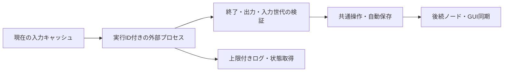

# 外部スクリプトによる表加工

2026-11-24に最小構成を実装した。Pythonやシェルなどの実行プログラムを別プロセスで起動し、入力なし、または一入力で文字列表を生成・加工できる。型付き列の設計は合意済みだが未実装のため、今回の入出力は文字列のみ。任意のCLI形式への変換、環境の自動構築、対話型・常駐プログラムは対象外。

## 操作

1. 「加工を追加」→「スクリプト」でノードを追加し、入力元を接続する。
2. 実行プログラム、スクリプト、作業フォルダの絶対パスを指定する。Python仮想環境は、その環境の`bin/python`を実行プログラムに指定する。
3. 追加引数は1行に1個。制限時間を指定し「設定を適用」で保存する。設定の保存だけでは実行しない。
4. 「内容を表示」で保存済み設定が参照するUTF-8スクリプトを読み取り専用で確認できる。
5. 「外部スクリプトを実行」で起動し、実行状態・ログを確認する。結果は後続の結果表などへ接続する。
6. 「停止・自動実行を解除」で、表示中の実行IDに対する停止を要求する。

[サンプル](../examples/script-uppercase.py)は全セルを大文字にして返し、処理行数を標準エラーへ出す。実行プログラムには既存のPython 3を指定する。ライブラリのインストールは不要。

実際には`実行プログラム スクリプトのパス 追加引数...`の引数配列で起動し、コマンド文字列のシェル展開はしない。空白を含むパスを引用符で囲む必要はない。シェルスクリプトなら実行プログラムに`/bin/sh`を指定する。入力は終了後にEOFを送る。標準入力への書き込みと標準出力・標準エラーの読み取りは並行する。

## 入出力形式：sagyodai-table バージョン1

UTF-8のJSON Linesで、最初の行は列情報、残りは各行の文字列配列（list）または列名をキーとするオブジェクト（dict）。入力・出力それぞれの行形式をノード設定で指定する。

```jsonl
{"format":"sagyodai-table","version":1,"columns":["商品","数量"]}
["りんご","8"]
["みかん","2"]
```

出力モード「表（JSON Lines）」では出力も同じ形式。列情報だけの出力は0行の成功結果になる。列の追加・削除・改名は可能だが、列参照は現在の表モデルどおり位置指定なので、後続設定を確認する。入力の列挿入・削除・移動は、スクリプト接続中は拒否する。接続を外して構成を変更し、再接続後に設定を確認する。列は1〜50列・列名1024バイト以内、行は5000行以内。数字やnullをJSON値として渡す形式はまだ受け付けない。将来の型付き形式とはバージョンを分ける。

標準出力にデバッグ文を混ぜると形式エラーになる。ログは標準エラーに出す。終了コード0かつ出力全体の検証成功時だけ結果を確定し、自動保存とSSE通知を行う。異常終了・形式不正・タイムアウト・キャンセル時は前回成功したキャッシュを保持し、エラーと更新待ちを示す。

## 実行と更新



- 通常の自動／手動設定と、外部プログラムを起動する許可は別。新規ノードは自動更新設定だが、許可前は起動しない。
- 実行時に「この設定の自動実行も許可する」を選ぶと、同じ設定・同じスクリプト内容について、入力変更後に自動実行できる。許可はコアのメモリだけに保持する。手動更新では上流変更に対して起動しない。
- 停止、設定変更、ノード削除、Undo／Redo、プロジェクト読み込み、コア終了で該当する許可を解除する。Undo／Redoとプロジェクト読み込みは全スクリプトの許可を解除し、実行中の結果も無効化する。保存済みプロジェクトの復元だけでプログラムを起動しない。
- 入力内容・列・接続・設定・手動設定が変わった実行は停止を要求し、結果を破棄する。入力が元に戻っても、途中で無効化した実行は採用しない。無関係なノード移動では実行結果を破棄しない。
- 同じノードの同時実行は拒否する。別ノードは合計4件まで。許可済み自動ノードは空きができれば実行する。失敗した同じ入力を自動で無限に再試行しない。
- スクリプトの原文は開始前・完了時に確認する。実行中に変更を検出した場合は結果を破棄し、自動実行の許可を解除する。許可後に原文が変わった場合、そのまま自動実行はしない。常時のファイル監視や、依存ライブラリ・実行ファイルの更新検出は未対応。
- 自動実行できない場合は明示実行で最新の内容を確認して許可し直す。現在のUIは実行状態を1秒ごとに取得する。
- ログと実行IDは最新の1実行分をノード単位でメモリに保持する。再起動後は消える。設定と成功キャッシュはプロジェクトに残る。

## プロセスの制限と停止

- スクリプト原文は100000バイト、追加引数は100個・各8192バイト以内。
- 入力・出力はそれぞれ10 MiB以内。標準出力の超過は実行失敗として停止する。
- ログは先頭64 KiBを保持し、以降は読み捨てて省略を表示する。ログの出力でパイプが詰まらないようにする。
- 制限時間は1〜3600秒、既定30秒。プロセス起動後の入出力・終了待ちに適用する。
- macOS／Unixでは実行ごとにプロセスグループを作り、停止時はTERM、猶予後にKILLを送り、直接の子を回収する。通常のコア終了（Ctrl+C／SIGTERM）でも停止処理を行う。
- 独立したセッションへ離脱するプログラム、コアの強制終了（SIGKILL）、OS障害まで含む子孫プロセスの終了は保証しない。対話型・常駐プログラムやWindowsのプロセス管理は未対応。
- 環境変数は`PATH`・`HOME`・`LANG`・`LC_ALL`・`TMPDIR`だけを継承する。任意の環境変数や秘密情報の設定UIは未対応。実行ファイルの絶対パスで既存環境を選ぶ。

別プロセス化はアクセス制限のサンドボックスではない。プログラムはコアと同じOSユーザーの権限でファイルやネットワークへアクセスする。外部への副作用はキャンセル・Undoで戻せず、失敗時の自動再送は行わない。スクリプト自体は外部ファイルを参照し、プロジェクトへ同梱しない。

## MCP

`apply_operation`で`script`ノードを追加し、`setScript`で設定する。通常の`run`は外部スクリプトを起動しない。

| ツール | 用途 |
| --- | --- |
| `script_source` | 設定済みファイルの原文を取得 |
| `start_script` | `id`・観測した`expectedRevision`・`allowAutomatic`を指定し、実行IDを取得 |
| `script_status` | 最新の実行状態・ログ・自動実行許可を取得 |
| `cancel_script` | `id`・`runId`を指定して停止要求と許可解除 |

明示実行はGUI・MCPとも同じ開始処理を使う。実行・停止のツールは外部副作用を伴うものとして公開する。通常の表編集も、許可済み自動スクリプトの入力を変えれば外部実行につながる。クライアント側で新しいツールが見えない場合はMCP接続を再起動する。

## 検証（2026-11-24）

- Rust: 正常終了、日本語ログ、0行、形式不正、異常終了、出力上限、ログ上限、タイムアウト、子プロセスを含むキャンセル。
- Rust: 保存・復元、共通Undo／Redo、成功キャッシュ維持、保存失敗、入力変更時の破棄、無関係な配置変更、スクリプト変更時の破棄、自動許可と手動更新。
- UI自動テスト: 設定保存と実行の区別、日本語の模擬composition入力と他タブ変更時の下書き保持、revision付き実行、実行ID付き停止。
- 実stdio: MCPからノード追加・接続・設定、原文取得、外部実行、ログ・結果取得。Python 3の`/usr/bin/python3`を検証に使用（テスト実行環境にも必要）。
- 分離した保存先とポートの実画面: 原文表示、実行成功、6行の出力と日本語ログ、80%ズームでの設定表示。
- 実IME候補選択、全ノードを組み合わせた大規模実行、OS強制終了、Windowsは未検証。任意CLIのデータ形式・型付き表・複数入出力・依存環境の自動作成は未実装。

## お気に入りとパスの選択

ヘッダーの「設定」で、名前・実行プログラム・任意の作業フォルダをお気に入りとして最大50件登録できる。Python仮想環境なら、その環境の `bin/python` を指定する。環境の作成・依存パッケージのインストールは行わない。

スクリプトノードの「お気に入りの環境・プログラム」から選ぶと、実行プログラムと登録済みの作業フォルダを入力欄にコピーする。お気に入りの作業フォルダが空なら現在の入力を維持する。スクリプト・引数・制限時間は維持し、各欄の直接入力も引き続き利用できる。「設定を適用」するまではノードに反映せず、選択だけで実行しない。登録内容の変更・削除は既存ノードに遡及しない。

実行プログラム・スクリプト・作業フォルダの「参照…」からアプリ内の選択ダイアログを開く。コアが動作するマシンのフォルダを辿り、ファイル、または「このフォルダを選択」で選ぶ。隠しフォルダ（`.venv` など）も表示し、シンボリックリンクのパスは解決せず保持する。これはOS標準のファイルダイアログではない。表示は1フォルダ2000項目までで、それを超える場合はパス直接入力を併用する。キャンセルは入力を変更しない。

お気に入りはプロジェクト外の設定として、コアの自動保存ファイルの拡張子を `.settings.json` に置き換えた隣接ファイルに保存する（標準は `.sagyodai/project-4318.settings.json`）。同じコアを利用するタブで共有し、再起動後も復元する。プロジェクト書き出し・Undoには含めない。別タブで先に設定が保存された場合は上書きを拒否し、下書きを残す。閉じて開き直して最新の設定を取得できる。設定形式はversion 1で、非対応・不正な形式は起動を中止し上書きしない。設定保存は一時ファイルからの置換で行い、保存失敗時には前の設定を維持する。

選択ダイアログの「名前で絞り込み」は、現在のフォルダの取得済み候補を大文字・小文字を区別せず部分一致で絞る。フォルダを移動すると絞り込みを解除する。サブフォルダ内の再帰検索は行わない。フォルダは黄土色、ファイルは青のアイコンで区別する。

## 入力なしの実行

入力元の「入力なし（標準入力は空）」を選ぶと、データを書き込まず標準入力を閉じて実行する（ヘッダーも送らない）。スクリプト側で表を生成し、選択した出力モードで標準出力に返す。接続された入力が更新待ち・エラーの場合は実行を拒否する。実行中の接続・切断は古い結果を破棄し、失敗時は前回成功した出力を維持する。入力なしでも明示実行・自動実行許可の規則は共通で、タイマーによる定期実行は行わない。

## 出力モード

ノードの「出力モード」で「表（JSON Lines）」（初期値）または「テキスト（UTF-8）」を選び、「設定を適用」する。テキストでは `print("こんにちは")` のような通常の標準出力を利用できる。全文を「本文」列の1行1セルとして保持し、改行・空白・末尾改行を変更しない。空出力も成功として空文字を保存する。「結果テキスト」に接続して表示でき、ノードの「出力プレビュー」でも確認できる。UTF-8不正、10 MiB超、異常終了は失敗とし、前回の結果を維持する。ログ用の標準エラーは出力と分けて扱う。

出力モードはノード設定として保存・Undo・MCPの `setScript`（`outputMode: "table" | "text"`）に対応する。変更は自動実行許可を解除し、実行中の古い結果を破棄する。入力接続時の標準入力は、どちらの出力モードでも表JSON Linesのまま。入力なしの場合は空の標準入力を閉じる。

## JSONLの行形式

「入力JSONLの行形式」「出力JSONLの行形式」で、リスト（配列）とdict（列名 → 値）を独立して選ぶ。初期値は両方ともリスト。出力の選択は表モード時に表示し、テキストモードでは使用しない。入力なしの場合は入力行形式にかかわらず空の標準入力を閉じる。

先頭の列情報は両形式で共通。例えば次のヘッダーに続ける行は、リストなら `["りんご","2"]`、dictなら `{"商品":"りんご","数量":"2"}` となる。

```json
{"format":"sagyodai-table","version":1,"columns":["商品","数量"]}
```

dictのキーの順番は自由で、結果の列順はヘッダーのcolumnsに従う。列名は一意である必要がある。出力行のキー不足・余分なキー・同名キーの重複、文字列以外の値（数値・null・配列など）はエラーにし、前回成功した出力を保持する。自動で型変換したり、キーを補完したりしない。形式を自動判定しないため、選んだ行形式とスクリプトの読み書きを合わせる。0行の場合もヘッダーは必要。

設定は保存・Undoと共通操作APIに含まれる。MCPの `setScript` では `inputRowFormat` / `outputRowFormat` に `"list"` または `"dict"` を指定する。変更は実行中の結果を無効化し、自動実行許可を解除する。
