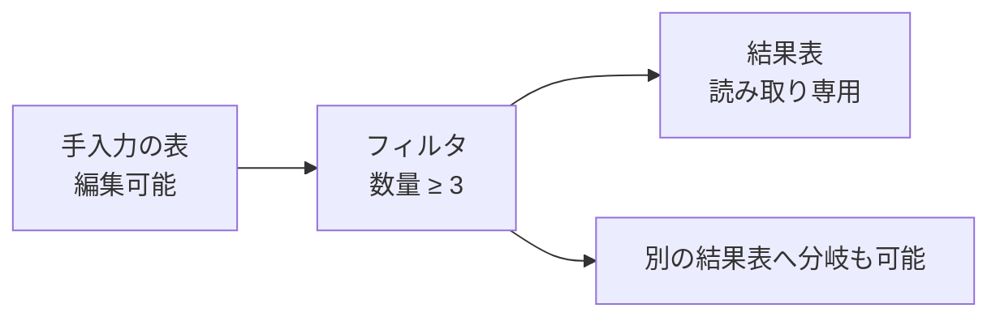

# 手入力の表 → フィルタ → 結果表

## 操作

1. 左上の「フィルタ」「結果表」でノードを追加する。手入力の表も含め、新しいノードは、そのタブで見えているキャンバスの中央付近に配置し、選択状態にする。ツールバーと操作ガイドを避ける。拡大しすぎて全体が入らない場合も見出しを画面内に残す。
2. 手入力の表の右端子からフィルタの左端子へ、フィルタの右端子から結果表の左端子へドラッグする。「入力元」の選択欄でも接続でき、「未接続」で切断できる。
3. フィルタは左から「対象列 → 比較方法 → 値」の一行で条件を読む。各項目を入力し、「条件を適用」を押す。例えば「数量」「数値 ≥」「3」。適用前の条件入力はローカルの下書きで、保存・別タブ同期の対象外。
4. 対象列・比較方法・値が適用済みの条件と異なる間は「未適用の変更あり」を表示し、適用ボタンを黄色で強調する。適用が反映された場合や元の条件へ戻した場合に表示が消える。手動実行の「更新待ち」とは別の状態で、「今すぐ更新」では下書きを適用しない。
5. 手入力のセルを変更すると、通常はフィルタと結果表が自動更新される。結果表には編集欄がなく、API からのセル変更も拒否する。

入力は一ノードにつき一つ、出力は複数へ分岐できる。フィルタを連結して段階的に絞り込むこともできる。結果表も出力端子を持ち、出力列の選択・順序・名前を加工して後続へ渡せる（[出力列設定](output-columns.md)）。循環・存在しない接続先・手入力表への入力接続は拒否する。

手入力・加工・表示ノードの「削除」でノードとその接続を除去する。後続のキャッシュは保持し、未接続として扱う。操作はプロジェクト共通の Undo / Redo で戻せる。最後の1ノードは削除できない。

操作ボタンは枠線・背景とアイコンを付け、条件適用は緑系、削除は赤系で区別する。アイコンには文字ラベルを併記し、Undo などアイコンのみの操作には読み上げ名を付ける。

ノード左上のアイコンは、手入力の表が「表＋鉛筆」、フィルタが「漏斗」、結果表が「表」。種類を示す表示で、操作ボタンではない。

## コンパクト表示

フィルタ見出しの「縮小」で、タイトルと、その下の一行に適用済み条件の要約・件数と更新状態をまとめた表示に切り替える。下部の空白を残さず、高さも詰める。「展開」で元のサイズと設定欄へ戻る。折りたたんだまま移動・接続でき、長い条件は省略表示する。

編集中の下書きは折りたたんでも保持し、未適用の表示を残す。適用するには展開する。表示モードは保存・別タブ同期・Undo / Redo の対象。展開時のサイズも保持する。

## 比較の意味

セルは引き続き文字列として保存する。列の型指定・null は未実装。

| 比較 | 挙動 |
| --- | --- |
| 文字列が一致／不一致 | 大文字小文字・空白を含め、そのまま比較 |
| いずれにも一致しない（NOT IN） | 選択値のいずれとも完全一致しない行を出力。未選択は全行 |
| いずれかに一致（IN） | 選択値のどれかに文字列として完全一致。空欄も選択可。未選択は0件 |
| 文字列を含む | 部分一致。空文字列はすべての行に一致 |
| 数値 = / != / > / ≥ / < / ≤ | 前後の空白を除いて有限の数値として比較。空欄・数値でないセルは一致しない |

数値の `=` と `!=` は文字列比較ではなく数値として比較する。例えば `3`・`3.0`・` 3 ` は等しく、空欄や数値でないセルは `!=` でも対象外。内部では既存の大小比較と同じ有限の倍精度浮動小数点数を使う。

数値の比較値が不正な場合や対象列がない場合はエラーとし、前回の成功結果を残す。0件は正常な結果で、列名は維持する。型変換自体は入力セルへ書き戻さない。

## 自動・手動更新とキャッシュ

- 初期値は自動更新。各フィルタ・結果表の「手動更新」で切り替える。
- 手動ノードは入力や条件の変更で更新待ちになり、前回の成功結果を維持する。「今すぐ更新」でそのノードを評価し、後続の自動ノードへ伝播する。
- 上流が未接続・エラー・更新待ちなら、後続も更新待ちとして前回結果を維持する。古い入力を最新と扱わない。
- 手動ノードが連続するときは上流から順に更新する。「今すぐ更新」は上流の手動ノードまで自動実行しない。
- 成功時だけキャッシュを置き換える。接続、条件、更新モード、配置、入力原本、出力キャッシュ、更新待ち・エラー状態をファイルへ保存する。読み込み時には自動再計算せず、その保存状態を復元する。

## 実装と制限

- `backend/src/domain.rs`: 入力・フィルタ・結果表の種類、条件、共通操作。
- `backend/src/graph.rs`: 接続検証、依存順の評価、比較、キャッシュ保持。
- `backend/src/application.rs`: 編集と評価を一操作として確定し、Undo / Redo と SSE 通知へ渡す。
- `src/features/filter/NodeSettings.tsx`: 入力元・条件・更新モードの操作。
- `src/features/canvas/TableNode.tsx`: 接続端子とノード表示。
- `src/features/table/TableGrid.tsx`: 入力表・読み取り専用結果表の表示。

小規模な表処理として、Rust の操作ロック内で評価を同期実行する。操作と結果が一度に確定するので、古い非同期結果が後から上書きすることはない。無関係な配置操作でも自動ノードは再評価する。重いスクリプトや大規模データに対応する実行キュー・差分再計算は今後の範囲。

既存の `Table` / `tables` は、この段階では表データを入出力に持つノードの共通レコードとして使用する。手入力の rows は原本、加工・表示の rows は成功時の出力キャッシュ。設定・接続は同じレコードの別フィールドに置く。表以外の入出力を導入する際はモデルを分ける。

上限は全種類を合計100ノード、各5000行・50列、保存ファイル8 MiB。行列はまだ添字で指定する。ファイル形式は **バージョン2**。合意済みの方針に従い、バージョン1の自動移行は実装しない。

## 検証記録（2026-11-22）

- Rust: 入力変更の伝播、分岐、日本語の文字列比較、数値比較と空欄、0件、手動更新と後続の停止、エラー時のキャッシュ維持、読み取り専用、共通 Undo / Redo、循環・不正接続の拒否、接続・条件・キャッシュ・エラーの保存復元。
- フロント: 結果表に編集欄がないこと、貼り付けても編集操作を送らないこと。既存の表編集・同期テストも実行。
- ブラウザー: 端子ドラッグと入力元選択で接続し、数量 ≥ 3 の結果を表示。入力変更で2件→1件、手動更新で前回結果を保持し、明示更新で2件へ反映。別タブへの結果反映、ファイルのダウンロード・読み込みによる接続・条件・結果の復元を確認。
- 実際の IME 候補選択、Windows、Tauri は引き続き未検証。

## 複数の値を選ぶ IN フィルタ

比較方法で「いずれかに一致（IN）」を選び、「N個の値を選択（IN）」を開く。入力列の重複を除いた候補と件数が表示され、複数選択・候補検索・全選択・選択解除ができる。「閉じる」の後、「条件を適用」でノードの出力に反映する。列ヘッダーの表示用絞り込みとは異なり、後続ノードにも抽出結果が渡る。

値は文字列の完全一致で、大文字小文字・空白・数値の表記を区別する。空文字は「（空欄）」として選択でき、何も選ばない場合は正常な0件となる。選択時点の値を条件として保存するため、後から増えた別の値は自動選択しない。入力から消えた選択値も0件の候補として残し、再出現したときには一致する。対象列を変更した際はINの選択を解除する。

適用済みの選択値は保存・復元・別タブ同期・Undoの対象。手動更新時は条件適用だけでは結果を置き換えず、「今すぐ更新」で抽出する。自動テストで完全一致・空欄・空選択・後続への伝播・保存復元・手動キャッシュ・Undoを確認。実画面では2分類の選択で1000行から500行を出力することを確認した。

### 選択値を除外する NOT IN

「いずれにも一致しない（NOT IN）」では、同じ候補メニューで除外する値を複数選ぶ。INとNOT INを切り替えても選択値は維持し、「条件を適用」で切り替えを確定する。未選択は全行を通し、全候補を選ぶと現在の入力は0件となる。空欄は選択した場合だけ除外する。文字列の完全一致・条件の保存復元・手動更新の扱いはINと共通。SQLのNULLは未対応で、空文字を通常の値として扱う。

NOT INは実画面でも3分類を除外して残りの250行だけが結果表へ出ること、選択解除後は1000行を通すこと、Undoで除外条件が戻ることを確認した。

## 表示のクイックフィルターから作成

手入力の表・CSV・結果表の「…」メニューから「クイックフィルターから作成」を選ぶと、適用中の列ヘッダーの値選択とクイック検索を処理用フィルターノードへコピーする。列ごとにINフィルター、検索があれば全列を対象にした部分一致フィルターを作り、元の表の出力から直列に接続する。検索は前後の空白を除き、大小文字を区別しない。各列の条件と検索はANDになる。表示ソートはコピーしない。

作成後は最後のフィルターが見える位置へビューを移動する。元の表示設定と既存の接続は維持し、作成後の条件は独立して編集できる。作成全体が一つのUndo単位となり、保存・復元・別タブ同期の対象になる。絞り込みがない場合はメニューを無効にし、必要なノード数が100個の上限を超える場合は一つも作成せずエラーにする。
