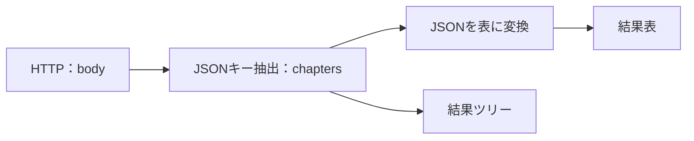

# JSON加工

「加工を追加」から「JSONキー抽出」「JSONを表に変換」を追加できる。HTTPのbodyやメモ・テキストなど、1列のJSONテキストを入力する。複数行は改行でつなぎ、一つのJSONとして解析する。

## JSONキー抽出

- 「キー名」にパスを指定し「キーを適用」で確定する。入力途中は「未適用」を表示する。構文エラーは入力欄で表示し、適用できない。
- `chapters[0].title` のように、ドットでオブジェクトの階層、角括弧で配列のインデックス（0始まり）を指定できる。入力自体が配列なら `[0].title` と指定する。
- ドット・空白などを含むキーや空のキーは `["a.b"]`・`[""]` のようにJSON形式の引用符付き角括弧で指定する。空の入力欄も直下の空文字キーを表す。ワイルドカードやJSONPathのルート記号には対応しない。
- 入力中の階層に応じてキー・配列インデックスを補完する。オブジェクトや配列の候補を選ぶと、続けて中の候補を選べる。部分一致（大文字・小文字を区別しない）で絞り込み、クリックまたは上下キー＋Enterで選択する。選択では適用せず「キーを適用」で確定する。Escapeで閉じる。自由入力も可能。候補は先頭100件まで、未接続・更新待ち・不正なJSONの場合は表示しない。
- 値がオブジェクト・配列・文字列・数値・真偽値・nullのいずれでも抽出できる。出力は「JSON」1列・1行のJSON文字列。文字列の引用符も保持するので、後続で再びJSONとして扱える。
- 途中の型が合わない場合、指定キーがない場合、配列の範囲外の場合はエラー。nullという値と、キーが存在しない場合を区別する。

## JSONを表に変換

- オブジェクト配列は1要素を1行、全要素のキーの和集合を列にする。列はキー名順、行は元の配列順。結果表で列の順序・名前・表示列を調整できる。
- 文字列はそのまま、数値・真偽値は文字列にする。欠けたキーとnullは空欄、入れ子のオブジェクト・配列はJSON文字列にする。再帰的に列へ展開しない。
- オブジェクトを含まない配列は「値」という1列にする。配列要素が配列の場合もJSON文字列のセルとして扱う。
- オブジェクトとそれ以外が混在する配列はエラー。
- 空配列は0行・0列、空オブジェクトだけの配列は要素数分の行・0列になる。
- このノード自身は設定・状態のみを表示する。表として見るときは「結果表」を接続する。

## 更新・保存と制限

- 自動／手動更新、今すぐ更新、コンパクト表示、Undo、別シート参照に対応する。
- 不正なJSON、キーなし、型違い、上限超過では前回の成功結果を保持する。入力や設定を修正すると自動更新で復帰する（手動ノードは今すぐ更新）。
- キー設定・接続・更新設定・出力キャッシュはプロジェクトに保存・復元する。
- JSON入力は11 MiB、パス・列名は1024バイト、出力は5000行・50列、各セル11 MiBまで。プロジェクト全体の上限は128 MiB。
- 表は現在文字列型のため、元のJSON型を表から完全には復元できない。数値の解析・再出力はRustのJSONパーサーの数値精度に従う。
