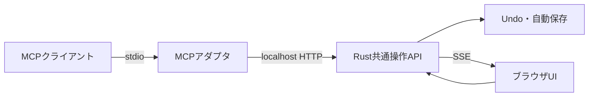

# MCPからの操作

2026-11-24に、初期目標のうち手入力表・フィルタ・結果表の構築と編集をMCPから行えるようにした。その後、[外部スクリプト](external-scripts.md)の設定・実行・ログ・停止を追加した。型付きセル、全ノードの設定操作まで完了したという意味ではない。

## 接続

1. `npm run dev` で通常どおりアプリを起動する。
2. `cargo build --manifest-path backend/Cargo.toml` で実行ファイルを作る。
3. MCPクライアントのstdioサーバーに以下を設定する。実行ファイルのパスは配置場所に合わせる。

```json
{
  "mcpServers": {
    "sagyodai": {
      "command": "/Users/jun/Unshared/apps/sagyodai/backend/target/debug/sagyodai-core",
      "args": ["--mcp"],
      "env": { "SAGYODAI_CORE_PORT": "4318" }
    }
  }
}
```

上記は`mcpServers`形式のクライアント設定例。クライアントによって外側の設定形式は異なる。実行コマンド・引数・環境変数は共通で、クライアント設定への自動登録は行わない。

アダプタは`127.0.0.1`の指定ポートに接続し、コアを自動起動したり保存ファイルを直接開いたりしない。通常起動と異なり、`.env.local`を読み込まないため、コアのポートを変えた場合はクライアントにも同じ値を指定する。MCPの標準出力はプロトコル専用。

コアが停止していればツールはエラーを返す。起動中のコアが対象なので、アプリを閉じた状態でのプロジェクト操作は実装していない。ブラウザを閉じてもコアが動いていれば操作は可能。

公式Rust SDK [rmcp](https://github.com/modelcontextprotocol/rust-sdk)をstdioプロトコルに使用する。



## 公開ツール

| ツール | 内容 |
| --- | --- |
| `get_project` | revision、シート、ノードID・接続・件数・自動／手動・更新待ち・エラー、Undo／Redo可否。セル内容は含めない |
| `get_node` | ノードIDを指定し、列・フィルタ条件・配置・更新状態と行データを部分取得 |
| `apply_operation` | 観測した`expectedRevision`と操作を指定。共通操作APIを通して確定し、更新後の概要を返す |

`get_node`の`offset`は0始まり、`limit`は既定20・最大100。0なら行を返さない。セル文字列は1個2048バイト、1回の行データは合計32768バイトまでとし、UTF-8境界で省略する。省略したセルの位置と元のバイト数は`truncatedCells`に返す。後続行があれば`nextOffset`を返す。省略値を完全な原本や編集前の値として扱わない。列名や設定などのメタデータはこの行データ上限に含まない。大きなセルの全文分割取得は未対応。

公開操作はノード追加（`input`・`filter`・`display`・`script`）、接続／切断、フィルタ条件と手動更新の指定、セル／範囲貼り付け、行列追加・削除、列名・ノード名変更、配置、ノード削除、再計算、Undo／Redo。引数の詳細は`tools/list`のJSON Schemaから取得できる。列・行は現在のGUIと同じ0始まりの位置指定で、安定した行列IDではない。セル値は文字列。

新しい手入力表にはGUIと同じサンプルが入る。必要なデータで上書きし、不要な行を削除する。新規IDは操作応答の`nodes`を確認する。条件や接続を作る途中も、GUIと同じ自動更新規則を適用する。一括編集・単位をまとめたUndoは未対応。

例：`get_project`でrevisionとノードIDを取得した後に、最初のセルを変更する。

```json
{
  "expectedRevision": 0,
  "command": {
    "type": "paste",
    "id": "table-1",
    "row": 0,
    "col": 0,
    "values": [["りんご"]]
  }
}
```

フィルタ条件例（数量が5より大きい）：

```json
{
  "expectedRevision": 4,
  "command": {
    "type": "configure",
    "id": "table-2",
    "manual": false,
    "filter": { "column": 1, "operator": "greater", "value": "5" }
  }
}
```

例のIDとrevisionは固定値として再利用せず、直前の取得結果から指定する。

## 競合・保存・実行範囲

- MCPはGUIと同じ検証・更新伝播・成功キャッシュ・Undo・自動保存・SSE通知を使う。変更前のrevisionが異なれば操作全体を拒否する。競合を隠すための自動再試行は行わない。
- `revision_conflict`では最新状態を確認して操作を再検討する。通信失敗ではサーバーで確定済みの可能性があるため、再送前に現在値とrevisionを確認する。
- 保存失敗は操作失敗として返し、元のファイルとメモリ状態を保持する。
- Undo／Redoはプロジェクト共通で、人間の直前操作も対象となる。履歴の永続化はない。
- `run`は組み込みノードの再計算。外部スクリプトには専用の`start_script`・`script_status`・`cancel_script`・`script_source`を使う。`setScript`で設定可能。許可済み自動スクリプトは入力変更からも起動する。HTTP再取得、外部ファイルへの専用の結果出力、プロジェクト全体の読み込み・置換は公開しない。通常編集にも自動保存によるプロジェクトファイルの更新は伴う。
- 既存の他種ノードの状態・出力も閲覧できるが、専用設定の編集は未対応。HTTP認証ヘッダーやメモ原文などをノード設定として返さない。ただし出力データに含まれる内容は閲覧できる。
- 読み取り専用サーバーやツール単位のアプリ内権限設定は未導入。MCPクライアント側の実行承認を利用する。接続先はローカル固定で、外部公開・認証付きリモート接続は対象外。

## 検証

共通の`npm run check`にRustテストと実stdioの接続テストを組み込む。接続テストだけなら`npm run test:mcp`。

- Rust: フロー構築、条件設定、自動／手動更新、結果取得、GUI用スナップショットとの一致、変更通知、共通Undo／Redo、保存からの復元。
- Rust: 古いrevision・不正操作の拒否、保存失敗時の状態維持、公開対象外の操作の拒否、取得範囲と日本語巨大セルの省略表示。
- 実プロセス: initialize、tools/list・tools/call、MCP編集→GUI用HTTP・SSEの反映、競合エラー、不正引数、コア停止時のエラー、コア再起動後のデータ復元。
- テストは一時ディレクトリと別ポートを使い、利用中の保存先を変更しない。
- 実MCPクライアントへの登録、ブラウザでの入力途中の競合や日本語IME操作は今回未検証。既存の同期UIは変更していない。
