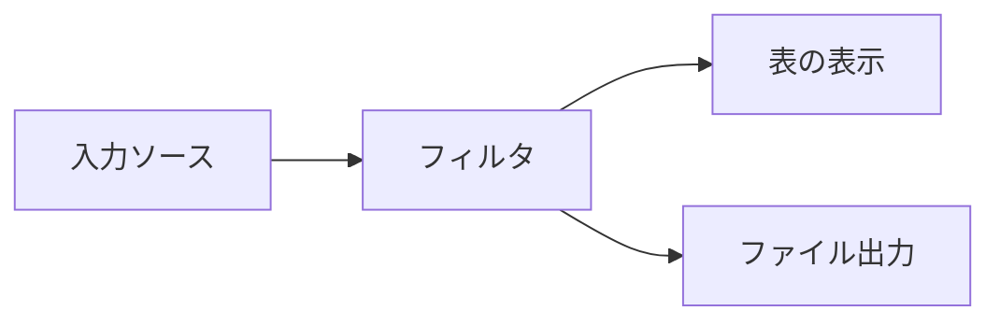
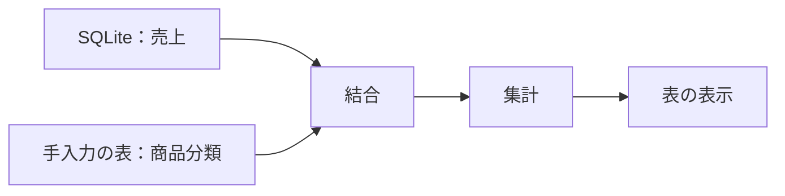
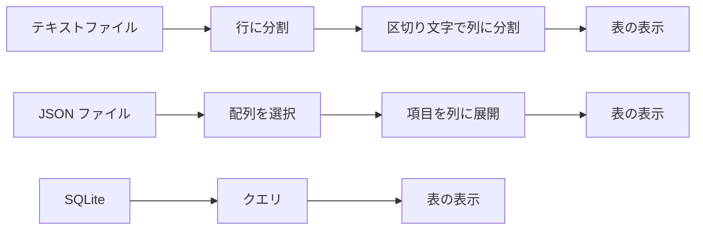
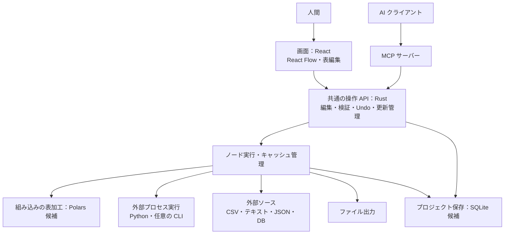
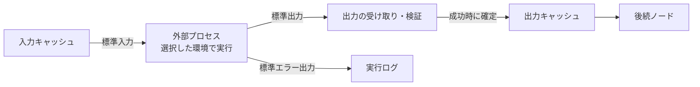
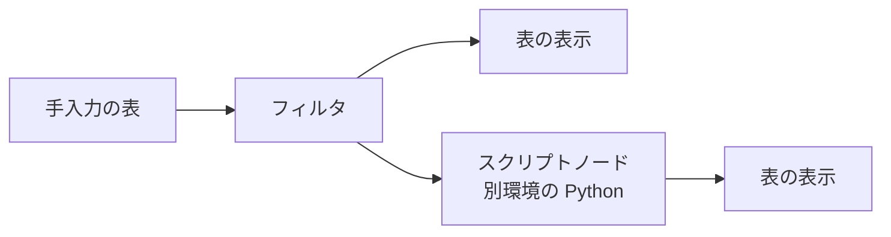

# 要件と設計方針

作成日: 2026-11-22

状態（2026-11-24）: キャンバス・表編集・データ加工・保存同期の試作は一区切り。実装範囲と残課題は[試作の到達点](prototype-review.md)を参照。次段階としてMCPの基本操作を実装した（[接続・範囲](mcp.md)）。[外部スクリプト](external-scripts.md)の文字列表加工とMCP操作も追加した。型付き列などは引き続き未実装で、初期目標全体の完了を意味しない。

この文書は、これまでの会話をもとに、合意した要件、提案段階の設計方針、未決定事項を整理したもの。設計案は実装方式の確定を意味しない。

コードの責務分割と実装規約は [ソースコードの方針](source-code-policy.md) にまとめる。

実装済みの範囲と検証記録は [キャンバス試作](canvas-prototype.md) と [プロジェクトファイル](project-files.md) を参照する。本書の要件全体や第 5 節の初期目標がすべて実装済みという意味ではない。

## 1. アプリの目的

ComfyUI のようなノードベースのデータ処理と、Apple Numbers のように自由に配置できる表を組み合わせたアプリを作る。

ノードと接続線を主役とするキャンバス上で、データの入力・編集・加工・表示・出力を扱う。ファイルを読み込まなくても、直接編集できる表ノードから作業を始められる。

後者は想定する利用例であり、結合・集計を含む具体的なノード一覧や初期実装範囲は未確定。

## 2. 合意した要件

### 2.1 キャンバスと表

- ノードをキャンバス上の好きな位置に配置できる。
- [メモノード](notes.md)でテキストを編集し、閲覧時はMarkdownとして表示できる。
- シートを追加してキャンバスを切り替えられる。タブのドラッグで並べ替え、右クリックからシート内のノードごと削除できる（最後のシートは保持）。別シートのノードも入力元として参照でき、計算とキャッシュはプロジェクト全体で共有する。操作と現状の制限は[シート](sheets.md)を参照。
- ノードを接続して処理フローを構築できる。
- 一つの出力を複数のノードに分岐できる。
- 複数表をまとめる結合ノードでUNION ALL／UNIONを切り替えられる。初期値はUNION ALL。列名・列数・並びの一致を必要とし、入力順で連結する。
- 直接編集できる表ノードを用意し、処理の入力として使えるようにする。
- フィルタなどの加工後の表は、当面は読み取り専用とする。
- 処理結果を表として表示できる。[結果テキスト](text-output.md)でテキスト／Markdown表示もできる。
- 手入力の表・結果表にクイック検索を設け、表示だけをインクリメンタルに絞り込める。列ヘッダーから値を複数選択する表示絞り込みと、昇順・降順の表示並べ替えにも対応する。元データやノードの出力には影響させない。クイック検索・列の絞り込み・表示順はプロジェクトに保存し、再起動後に復元する。
- 結果表では列の選択・並べ替え・列名の指定ができる。この設定は出力データにも適用し、結果表から後続ノードへ接続できる。詳細は[結果表の出力列](output-columns.md)を参照。
- 手入力の表・結果表に集計フッターを追加できる。集計方法はSUMと最頻値。フッターはデータ行に含めない。

- [結果ツリー](tree-output.md)でJSONテキストを開閉可能なツリーとして表示できる。

### 2.2 入力と出力

- [JSON加工](json-transform.md)でキーの値を抽出し、JSON配列を表へ変換できる。

- [HTTP入力](http-input.md)でリクエストのレスポンスを取得し、raw／headers／bodyを選んで出力する。外部通信は明示的なリクエスト操作で行う。

- UTF-8の[テキストファイル入力](text-input.md)に対応し、改行ごとに1列の表として後続ノードへ出力できる。

- 入力を CSV に限定しない。
- 手入力の表、CSV、プレーンテキスト、JSON、SQLite などの DB ソースを扱えることを目指す。
- 加工結果をファイルに出力できる。
- 対応する DB、ファイル形式、各ソースの詳細仕様と実装順序は別途決める。

### 2.3 更新とキャッシュ

- 各ノードの出力をキャッシュする。
- デフォルトは自動更新とする。
- 重い処理などに対応するため、ノードごとに手動更新へ切り替えられる。
- キャッシュはアプリを閉じても残す。

### 2.4 プロジェクト保存

以下をまとめてプロジェクトとして保存・復元できるようにする。

- シート一覧・順序・名前とノードの所属。
- ノードの配置。
- ノード間の接続。
- ノードの設定と自動／手動更新の選択。
- 手入力した表の内容。
- 各ノードの出力キャッシュ。

### 2.5 AI による操作

- MCP に対応し、AI がプロジェクトをある程度操作できるようにする。
- AI に便利な機能や MCP インターフェースの詳細検討は、AI 側に任されている。
- 操作可能な範囲と外部への書き込み権限の具体的な仕様は未確定。

### 2.6 スクリプトによる加工

- Python などの外部スクリプトや CLI を使ってデータを加工できるようにする。
- スクリプトノードはアプリ本体とは別プロセスで実行できる構成とする。
- ライブラリの競合を避けるため、ノードごとに実行環境を選択可能にする。互換性のあるノードでは環境を共有してもよい。
- シェルのパイプのように、標準入力からデータを受け取り、標準出力へ結果を返す方式を基本方針とする。
- 組み込みノードと外部プロセスのノードを同じフローに接続し、キャッシュと自動／手動更新を共通に扱う。
- 初期実装範囲は第 5 節にまとめる。具体的な入出力仕様と環境管理の詳細は未決定。

### 2.7 当面の利用者とファイル互換性

- 当面は作者本人のみが使う個人利用の初期開発版とする。
- 機能追加や内部構造の変更に際して、旧プロジェクトファイルとの互換性は保証しない。
- 旧形式からの移行処理、旧バージョンのアプリとの互換性維持、他の利用者への配布・更新対応は初期目標に含めない。
- 形式のバージョン番号はファイルに記録する。非対応の形式は明示的に開けないことを伝え、誤って解釈・上書きしない。
- 現行版での保存・再開と、保存失敗で元のファイルを壊さないことは初期目標に含める。互換性を保証しない方針と、保存の整合性は分けて扱う。

### 2.8 対象 OS・データ規模・スクリプト表示

- 最初の対象 OS は macOS とする。将来 Windows にも対応する方針とし、初期版での Windows 対応は求めない。
- 通常の利用では数百件程度を想定する。将来テキストファイルなどを読み込む場合は数千件になる可能性がある。これは利用規模の目安であり、固定の上限ではない。
- スクリプトは当初は外部エディタで編集し、アプリ内では内容を読み取り専用で表示できるようにする。アプリ内の編集機能は初期対象外とする。

### 2.9 ソースコードの基本方針

- 中核は Rust とし、画面の言語は TypeScript とする。画面・デスクトップの具体的なフレームワークの採用は別途確定する。
- UI・操作処理・実行処理・保存処理の責務を分ける。
- プロジェクトの正式な状態を Rust 側で管理し、GUI・MCP から共通の操作 API を通して編集する。
- 詳細は [ソースコードの方針](source-code-policy.md) に従う。

### 2.10 列の型と入力原文（2026-11-24合意・未実装）

- 列ごとに型を指定し、後続ノードにも型を引き継ぐ。最初の型は文字列・数値・真偽値とし、新しい手入力列の初期値は文字列型とする。日付・日時型は今回の導入範囲に含めず、必要になった段階で検討する。
- nullは独立した列の型ではなく、各型の列に入る「値がない」状態として扱う。文字列の空文字、数値の0、真偽値のfalseとは区別し、画面でも見分けられるようにする。具体的な表示・入力方法は未決定。
- 手入力の原文を保持し、型に合わない入力も原文を保存してセルにエラーを表示する。例として、数値列に「未定」と入力した場合、0やnullへの置換や集計からの暗黙の除外は行わない。
- 型エラーがあるノードは新しい出力を確定せず、前回成功した出力を維持する。後続にも更新待ち・エラーを示し、古い結果を最新と誤認させない。成功結果がない場合は出力なしとして扱う。
- 手入力表の型は列ヘッダーから指定する。読み込み後のデータには型変換ノードを用意し、入力原本を保持したまま変換をフローとして明示する。
- 自動推定を導入する場合は型の候補提示にとどめ、利用者の指定なしに値を変換しない。文字列の「00123」などはそのまま保持する。
- 型の導入と合わせて安定した列IDを導入する。列はID・名前・型を持ち、フィルタや集計は列IDで参照する。名前や表示順を変えても参照を維持し、型を変えた場合は後続処理の成立を再検証する。
- GUI・MCPで同じ型・変換・エラーの規則を使う。確定した原文・型設定は自動保存とUndoの対象にし、成功キャッシュと区別する。編集中で未確定の入力の障害復旧は、この合意には含めない。

現在の実装は文字列セルと加工ごとの数値解釈のままであり、上記は設計の合意である。数値の内部表現（倍精度浮動小数点、整数、十進小数など）は未決定。既存の倍精度実装を、そのまま採用決定したものとは扱わない。詳細の未決定事項は第4.2節を参照する。

## 3. 設計方針案

この節は会話中の提案を整理したもの。要件を満たすための候補として扱う。

### 3.1 ノードとデータの種類

| 役割 | ノードの候補 |
| --- | --- |
| 入力 | 手入力の表、CSV、テキスト、JSON、SQLite |
| 変換・加工 | 行への分割、列への分割、JSON の項目抽出、フィルタ、列追加、結合、集計 |
| 表示 | 表、テキスト、JSON ツリー |
| 出力 | CSV、JSON、テキストの保存 |

接続口には「表」「テキスト」「JSON」などのデータ型を持たせ、接続可能か検証する。すべての入力を最初から表として扱うことは前提にしない。

CSV などの頻出操作は、読み込みから表への変換までを一つのノードで済ませられるようにする案がある。

手入力の表はノード内で編集可能にし、加工ノードには結果の一部をプレビューする機能、表の表示ノードには広い表示領域を持たせる。ノードの大きさも保存対象とする案。

### 3.2 更新状態とキャッシュの扱い

各ノードは最後に成功した出力を保持し、新しい処理が成功した時点で差し替える。

| 状態 | 想定する挙動 |
| --- | --- |
| 最新 | 現在の入力・設定に対応する出力を保持している |
| 更新待ち | 入力・設定が変わったが、出力は前回のまま |
| 実行中 | 前回の出力を保持しながら新しい結果を計算する |
| エラー | エラーを表示し、前回成功した出力があれば残す |

まだ成功した出力がない場合は、キャッシュなしとして扱う。実行状態とキャッシュの鮮度を別々に表現するかは、状態モデルの詳細設計で決める。

手動ノードでは、自動更新の伝播をいったん止める。

入力を編集しても、集計と表示は前回の結果を維持する。集計を明示的に実行し、新しい結果ができたら後続を更新する。後続にも「上流に未反映の変更あり」と表示し、古い結果を最新と誤認しないようにする。

そのほかの方針案:

- セル編集の確定を更新の契機とし、連続した変更はまとめて処理する。
- 計算中に入力が変わった場合、古い実行結果が新しい結果を上書きしないようにする。
- 分岐先は同じ出力キャッシュを共有し、分岐ごとに同じ処理を実行しない。
- 外部ソースからの再取得と、取得済みデータの再加工を分離する。
- ファイル監視や DB の定期取得は、ソースノード側の設定として扱う。
- ファイル出力は初期状態では手動とし、明示的に自動保存を選べる案とする。これは自動更新の原則に対する例外案で、未確定。

### 3.3 永続化と再開

手入力の表は原本、キャッシュは再生成可能な結果として区別する。キャッシュ削除操作で手入力データを失わないようにする。

要件にある保存対象に加え、以下も保存する案とする。

- キャンバスの表示位置・ズーム、ノードの大きさ。
- 外部ソースの参照先。
- 出力の取得・計算日時。
- どの入力・設定に対応するキャッシュかを判定する情報。
- 未反映の変更と更新状態。

再開時の挙動案:

1. 保存済みの結果をまず表示する。
2. 更新待ちの自動ノードは再計算する。
3. 手動ノードは明示的な実行まで前回の結果を維持する。
4. 実行途中で閉じた場合は、最後に成功した出力を復元する。計算途中からの継続は前提にしない。
5. 外部ファイルや DB にアクセスできなくても、保存済みの結果は閲覧できる。

外部ソースには最終取得日時を表示する。キャッシュがあることと、現在の外部データと一致することは区別する。プロジェクトを開いた際に外部ソースを再取得するかは別途設定を検討する。

元ファイルの同梱とキャッシュ保存は別の機能として扱う。参照先と取得済みデータを保存する方式を基本候補とし、元ファイルも含めて持ち運べる方式は将来の選択肢とする。

### 3.4 保存形式と SQLite

利用者からは一つのプロジェクトファイルとして扱える形式を候補とする。内部の保存先として SQLite が挙がっているが、採用は確定していない。現在の試作では JSON 形式で表の内容と配置を保存・読み込みできる。これは出力キャッシュなどを含む最終的な保存方式の確定ではない。

SQLite を使う場合も、画面上の表をそのまま SQLite のテーブル構造に対応させる必要はない。自由な列追加・削除・並べ替えのために、次の保存方式が候補になる。

| 保存用テーブル | 内容 |
| --- | --- |
| 表の一覧 | 表 ID、名前 |
| 列の一覧 | 列 ID、所属する表、名前、型、表示順 |
| 行の一覧 | 行 ID、所属する表、表示順 |
| セルの値 | 行 ID、列 ID、値 |

この方式では、画面上の列変更をデータの追加・削除・更新として処理でき、毎回 DB のスキーマを変更する必要がない。安定した列 ID により、列名の変更後も後続ノードの参照を維持できる設計にする。

一方、セル単位の保存は大きな表でレコード数が増える。手入力の表と、大量の処理結果キャッシュで保存方式を分ける案がある。データ量、読み書き性能、型の保持方法を確認してから決定する。

参考: SQLite 自体も列の追加・削除に対応するが、追加位置や削除時の制約・データ書き直しを考慮する必要がある。[SQLite 公式 ALTER TABLE ドキュメント](https://www.sqlite.org/lang_altertable.html)

### 3.5 MCP と AI 向け操作

アプリを MCP サーバーとして操作可能にし、GUI と MCP を同じプロジェクトへの二つの操作口とする。画面のクリック操作ではなく、機能単位の操作を公開する。

| 機能 | 目的 |
| --- | --- |
| プロジェクト概要の取得 | ノード・接続・役割・エラー・更新待ちをまとめて把握する |
| ノード機能の探索 | 利用可能なノード、設定項目、入出力の型を調べる |
| データの部分取得 | 列情報、サンプル、指定範囲、件数、簡単な統計を調べる |
| ノードと接続の編集 | ノードの追加、接続、条件設定、配置変更を行う |
| 手入力の表の編集 | 行・列の追加や削除、セルの変更を行う |
| 実行前検証 | 接続の型不一致、存在しない列、設定不足を検出する |
| 一括編集 | 複数の変更をまとめて適用し、構築途中のフローの自動実行を防ぐ |
| 実行の制御 | 明示的な実行、進捗・完了確認、キャンセルを行う |
| 履歴と Undo | AI が何を変更したか確認し、一連の変更を取り消す |
| 自動配置 | 人間が読めるフローに配置を整える |

共通の設計方針:

- GUI と MCP から共通の操作処理を呼び、検証・更新判定・保存の挙動をそろえる。
- MCP 経由でもノードの自動／手動更新ルールを守る。
- 名前だけでなく安定した ID で操作対象を指定する。
- 人間との同時編集では、古い状態を前提とした上書きを検出する。
- キャッシュの内容だけでなく、生成元の入力・設定、鮮度も取得できるようにする。
- 大量データを毎回 AI に渡さず、範囲指定や取得量の制限を設ける。
- エラーは原因や対象を構造化し、AI が次の修正を判断できる情報を返す。
- プロジェクト内の編集と、外部ファイル・DB への書き込みを権限上区別する。
- Undo で戻せるプロジェクト内の変更と、外部への副作用を区別する。

AI 向け機能の最初の到達点は「手入力の表を作り、加工フローを組み、実行結果を確認する」一連の操作を扱えることとする案。具体的なツール名・引数・通信方式は詳細設計で決める。

### 3.6 技術構成の候補

中核の Rust と画面の言語 TypeScript は採用方針を確定した。ローカルのデスクトップアプリを第一候補として以下の構成を検討し、各フレームワーク・ライブラリの採用とバージョンは検証後に確定する。

現在のキャンバス試作では React・React Flow・Vite を導入し、表は通常の HTML 入力欄で実装している。Rust コアには試作用の axum HTTP アダプタで接続する。Tauri への組み込みと Glide Data Grid の採否は保留する。MCPのstdioアダプタには公式Rust SDKのrmcpを導入した。

| 担当 | 第一候補 | 役割 |
| --- | --- | --- |
| デスクトップアプリ | Tauri | ウィンドウ、ローカルファイルへのアクセス、配布 |
| 画面 | TypeScript + React（試作に導入） | 設定画面と編集 UI |
| ノードキャンバス | React Flow（試作に導入） | 配置、接続、拡大縮小、ノード内の独自 UI |
| 表の表示・編集 | HTML 入力欄で試作、Glide Data Grid は保留 | セル表示・編集、範囲選択、貼り付け |
| アプリの中核 | Rust（確定） | 共通の操作 API、プロジェクト管理、Undo、更新・実行制御 |
| 表データの加工 | Polars | フィルタ、列計算、結合、集計 |
| プロジェクト保存 | SQLite | 設定、手入力データ、履歴、永続キャッシュの保存先候補 |
| MCP | 公式 Rust SDK `rmcp`（導入済み） | stdioから起動中のコアの共通操作APIへ接続 |
| 外部スクリプト | 選択した環境の Python または任意の CLI | 別プロセスで実行する加工処理 |

設計上の役割分担:

- Rust 側にデータと実行状態を持ち、画面には表示中の行やプレビューなど必要な範囲を渡す。
- 重い処理は UI や操作受付を止めない実行枠へ分離する。
- Polars は表の加工を担当し、ノードの接続、更新状態、キャッシュの鮮度はアプリ側が管理する。
- ノードごとの出力保存と、複数処理をまとめる遅延実行の最適化にはトレードオフがある。初期案ではノードごとの結果の確定・保存を優先する。
- SQLite を採用しても、加工処理をすべて SQL で実装することは前提にしない。保存方式と処理エンジンを分離する。
- MCP は開いているプロジェクトを管理する中核へ操作を送る。別プロセスからプロジェクトファイルを直接書き換える構成にはしない。

採用前に、キャンバス内の表で日本語 IME、複数セルのコピー＆ペースト、ズーム中の編集、複数の大きな表の操作感を検証する。キャンバスの移動とセル選択・スクロールの操作競合にも注意する。

Rust の採用前に比較した代替構成（現在の採用方針ではない）:

| 重視する条件 | 比較する構成 |
| --- | --- |
| JavaScript / TypeScript に開発を寄せる | Electron を軸にした構成 |
| Python ライブラリを中核に据える | Python の処理サービスを持つ構成 |
| SQL を中心に分析する | Polars の代わりに DuckDB を使う構成 |
| ブラウザから共同作業する | サーバーを持つ Web アプリ構成 |

外部 Python スクリプトへの対応だけであれば、中核全体を Python にする必要はなく、スクリプトノードから利用できる。

参考資料:

- [Tauri のアーキテクチャ](https://v2.tauri.app/concept/architecture/)
- [React Flow のカスタムノード](https://reactflow.dev/learn/customization/custom-nodes)
- [Glide Data Grid の編集 API](https://docs.grid.glideapps.com/api/dataeditor/editing)
- [Polars の遅延実行](https://docs.pola.rs/user-guide/concepts/lazy-api/)
- [MCP 公式 Rust SDK](https://github.com/modelcontextprotocol/rust-sdk)

### 3.7 スクリプトノードの設計方針

最小実装として、既存環境の別プロセスによる文字列表加工を追加済み。現行のJSON Lines仕様、実行許可と自動更新、ログ・停止・上限は[外部スクリプト](external-scripts.md)を参照。以下の候補のうち、任意CLI形式・環境変数の指定などは未実装。

外部プロセスによる加工を採用方針とする。組み込みノードを Rust 内で実行し、スクリプトノードを選択した環境の別プロセスで実行する。

別プロセスであっても同じ Python 環境を使用すれば依存パッケージの競合は残るため、プロセスの分離と依存環境の分離を両方扱う。ノードごとに専用の仮想環境にある実行プログラムを指定でき、互換性のあるノード間では同じ環境を共有できる形とする。

設定項目の候補:

| 項目 | 内容 |
| --- | --- |
| 実行プログラム | 仮想環境の Python、任意の CLI のパス |
| 引数 | スクリプトのパス、処理オプション |
| 作業ディレクトリ | 相対パスを解決する場所 |
| 実行環境 | 使用する環境、必要な環境変数 |
| 入出力形式 | テキスト、JSON、JSON Lines などの候補から指定 |
| 実行制限 | タイムアウト、キャンセルなど |

標準入出力の役割:

- 標準入力: 入力データ。
- 標準出力: 加工結果。
- 標準エラー出力: ログと診断情報。
- 終了コード: 成功・失敗の判定に使う。

初期案では、入力キャッシュを渡し、処理が成功して出力が有効であることを確認してから結果を確定する。失敗時は前回成功したキャッシュを維持する。後続ノードは確定した結果を受け取るため、処理途中の結果を次々と流すストリーミング実行とは区別する。

入力・設定だけでなくスクリプトの変更も更新判定に含める。実行環境の変更をどのように検出するかは未決定。キャンセル時は起動した子プロセスも含めて終了を管理する方針とし、OS ごとの実装や終了できない場合の扱いは詳細設計で決める。

初期段階では既存の実行環境を指定する方法を候補とする。環境の自動作成、依存関係の固定・復元、プロジェクトへのスクリプト同梱は追加検討とする。

MCP から設定・実行・ログ確認を行えるようにする。任意プログラムの実行は通常の組み込み表加工とは別の権限として扱う。外部への副作用はプロジェクトの Undo では戻せない。別プロセス化や仮想環境はアクセス制限を伴うサンドボックスとは異なり、その制限方式の採否は未決定。

## 4. 未決定事項

### 4.1 初期実装範囲と利用環境

- macOS 向けの提供形態と対応 OS バージョン。将来の Windows 対応時期と対応バージョン。
- 3.6 の候補技術の採否、バージョン、配布方法。
- 初期範囲は第 5 節を基準とし、その後に追加する形式・DB・加工ノードの優先順位を決める。
- 通常数百件・場合によって数千件という目安に対する列数・データ容量・許容応答時間。ノード数の目安は未決定。

### 4.2 表とデータモデル

- 列単位の文字列・数値・真偽値、各型のnull、入力原文の保持と型エラー時の出力停止は第2.10節で合意済み・未実装。
- 数値の内部表現・精度・範囲、整数と小数を区別するか、金額の厳密な十進計算を初回から扱うか。
- 空欄、セル削除、貼り付け、CSV読み込みでの空文字とnullの指定・変換規則。数値・真偽値として受け付ける文字表現と空白の扱い。
- フィルタ・集計・ソート・UNIONなどでのnullと型の扱い、型変換ノードの詳細、JSON由来の型や混在する値の扱い。
- 原文・型付き値・セルエラー・成功キャッシュを区別する内部構造と、保存形式・MCPの表現。
- 初期対象外とする表計算の数式、セル参照、書式設定を将来どこまで扱うか。
- 列IDによる参照と名前・表示順の変更時の維持は合意済み。列の削除、加工で生成される列のID、入力接続の変更時の参照規則は未決定。行IDの具体的な導入方法も未決定。
- 加工結果を独立した編集可能な表として取り出す機能の要否。
- テキスト・JSON・表以外の入出力データ型。

### 4.3 実行とキャッシュ

- 自動更新の待ち時間、並列実行数、キャンセルと再実行の規則。
- 手動ノードが複数ある場合や、一部の入力だけ更新待ちの場合の実行範囲。
- 現在の表フローは循環接続を拒否する。将来、反復処理を導入する場合の仕様は未決定。
- キャッシュの有効性を判定する仕組み、容量制限、削除・圧縮方針。
- 外部ソースの監視・定期取得・起動時再取得の設定。
- ファイル出力の手動デフォルトと自動保存の扱い。

### 4.4 保存と復元

- SQLite の採否と、編集データ・キャッシュそれぞれの格納方式。
- 初期目標の単一プロジェクトファイルを実現する内部形式。
- 確定操作のサーバー側自動保存と起動時復元を実装。未確定入力の復旧、世代別バックアップの仕様は未決定。
- 外部ファイルの相対／絶対パス、参照切れへの対応、元ファイル同梱。
- DB の認証情報など、秘密情報の保存方法。
- 形式バージョンの識別方法。旧形式の移行処理は当面不要とし、互換性保証を開始する時期は未決定。

### 4.5 MCP と操作履歴

- MCPはstdioアダプタから、ポートで指定した起動中のコアへ接続する。複数プロジェクトの切り替えUIや別の通信方式は未決定。
- 最小ツールは状態概要・ノードの部分取得・操作実行を実装。追加のツール・リソースは未決定（[MCP操作](mcp.md)）。
- 初期対象外とする、アプリを閉じた状態での AI 操作を将来導入するか。
- 一括編集の失敗時の扱い、Undo の単位。履歴の永続保存は初期目標に含めない。
- 別タブ間は SSE で通知し、編集中の入力を保持する。同じセルの変更は値の比較で検出し、再適用・破棄を選ぶ。Undo は当面プロジェクト共通。詳細は [別タブ間の同期](tab-sync.md)。MCPの変更も同じ通知・Undoに参加し、観測したrevisionの一致を必須とする。
- 閲覧、編集・計算、外部書き込みの権限と確認 UI。
- 外部への書き込みを含む実行で、古いキャッシュを使う場合の扱い。

### 4.6 スクリプトノード

- 現行JSON Linesはバージョン1の列ヘッダーと文字列配列、空結果はヘッダーだけ。将来の型付き表、列ID、数値精度の表現は未決定。
- 大容量データ向けのバイナリ形式や一時ファイル経由の入出力を導入するか。
- 初期範囲の一入力・一出力を超える、複数入力・複数出力の表現方法。
- ノード間のストリーミング実行の要否と実装時期。
- 環境指定 UI、仮想環境の自動作成、依存関係の固定・復元方法。
- スクリプトをプロジェクトに内包するか、外部ファイルを参照するか。
- スクリプトと依存環境の変更をキャッシュの更新判定へ反映する方法。
- 実行時間・出力量・ログ量の上限、並列実行、プロセス終了の詳細。
- 任意プログラム実行の権限、外部アクセス制限の要否、環境変数など秘密情報の扱い。

## 5. 最初に作る範囲

最初の目標は「手入力した表を加工し、別環境の Python にも渡せて、保存して開き直せる。その一連の操作を AI からもできる」こととする。初期実装の基準として以下の範囲に絞り、長期的な対応要件とは区別する。

### 5.1 対応する機能

| 項目 | 初期範囲 |
| --- | --- |
| キャンバス | ノードの追加・削除・移動・サイズ変更、接続、パン・ズーム |
| 手入力の表 | 列単位の文字列・数値・真偽値と各型のnull、原文保持と型エラー表示（第2.10節）。セル編集、行列の追加・削除、範囲貼り付け |
| 集計 | 複数列によるグループ化、数値列の合計・平均・最小値・最大値、グループ内の行数。出力列ごとに関数・対象列・列名を指定 |
| ソート | 複数列の優先順、列ごとの昇順／降順と数値／テキスト比較 |
| フィルタ | 一つの列に対する比較・一致条件、複数の値との完全一致・除外（IN／NOT IN） |
| 表の表示 | 読み取り専用、件数・更新状態・エラーの表示 |
| 実行 | 自動／手動更新、前回成功した出力キャッシュの保持 |
| スクリプト | 実行ファイル・引数・作業ディレクトリを指定し、別プロセスで実行。スクリプト内容の読み取り専用表示、ログ確認とキャンセル |
| 保存・復元 | 配置・接続・設定・手入力データ・キャッシュを一つのプロジェクトファイルとして保存・復元 |
| MCP | 状態取得、表編集、ノード追加・接続・設定、実行、結果・ログの取得 |

スクリプトノードは、現在一入力・一出力の文字列表を JSON Lines で受け渡す。既存の Python 仮想環境の実行ファイルを指定し、アプリによる環境の自動構築は行わない。現行の空結果は列ヘッダーだけで表現する。将来の型付き表の入出力仕様は未決定。

### 5.2 最初から用意する土台

- 表・列・ノードなどの安定した ID。
- GUI と MCP が共通で呼び出す操作 API。
- プロジェクト内の編集に対する Undo。履歴の永続保存は含めない。
- 入力変更や再実行の後に、古い計算結果が新しい結果を上書きしない仕組み。
- 形式バージョンの識別と非対応形式の拒否。旧形式の移行は不要。
- 保存失敗で元のプロジェクトファイルを壊さない保存処理。

### 5.3 完成条件

1. 手入力の表を作り、フィルタと二つの表示先を接続できる。
2. セルを変更すると自動更新され、手動ノードでは更新が止まる。明示的に実行すると後続へ結果が反映される。
3. 選択した環境の Python で加工できる。失敗しても前回の結果が残り、ログを確認できる。
4. 保存して終了し、同じ形式に対応する現行版で開き直すと、配置・接続・設定・手入力データ・前回の結果が戻る。
5. AI が MCP で条件を変更すると画面に反映され、結果も取得できる。表の作成からフローの構築・実行までの操作も MCP から行える。

### 5.4 初期対象外

- Windows 対応。将来の対応対象とする。
- アプリ内でのスクリプト編集。初期版は内容の表示までとする。
- CSV 出力。CSV読み込みは初期目標の後続機能として追加済み（UTF-8・ファイル選択方式）。詳細は[CSV入力](csv-input.md)。
- 専用のJSONファイル入力ノードやSQLiteなどのDBソース。汎用テキスト入力・HTTP入力とJSON加工は試作に追加済み。その他の外部入出力は未決定。
- 当初対象外だったUNION／UNION ALL結合・集計・ソート・置換・JSON加工は、試作の検討中に追加済み。その他の追加ノードの範囲は未決定。
- 数式、セル参照、装飾、グラフなどの高度な表計算機能。
- ファイル監視、定期実行。
- Python 環境の自動作成、依存関係の自動インストール。
- ノード間のストリーミング、大容量向け最適化。
- 複数利用者による共同編集、プラグイン配布、他の利用者への配布・更新対応。
- アプリを閉じた状態での MCP 操作。
- Undo 履歴の永続保存、旧プロジェクト形式の移行や互換性維持。

個人利用でも、人間と AI が同じプロジェクトを操作することは想定する。複数利用者向けの共同編集を対象外とすることと、GUI・MCP 間の状態整合性は区別する。

## 6. 当初の進め方と現在の区切り

以下は当初の案。キャンバスと表編集、加工・表示・保存・同期の試作は一区切りとし、次段階の順序は[引き継ぎ文書](prototype-review.md)の検討事項から改めて選ぶ。

1. macOS と通常数百件・場合によって数千件という利用規模を前提に、第 5 節の検証用データとスクリプトの入出力仕様を具体化する。
2. キャンバス内の表編集を小さく試作し、日本語入力やズーム時の操作感を検証する。
3. 表・ノード・接続・更新状態のデータモデルと、GUI・MCP 共通の操作 API を設計する。
4. 永続化とキャッシュの方式、および外部プロセスとの入出力を小規模な検証で比較する。
5. 手入力の表 → フィルタ → 表示 → 保存・再開を一通り実装する。
6. 別の Python 環境を使うスクリプトノードを組み込み、結果の確定・失敗時のキャッシュ維持・キャンセルを確認する。
7. 共通の操作 API に MCP の接続部分を載せ、AI から一連の操作ができることを確認する。

キャンバスと文字列の表編集に加え、シート、各種入力・加工・結果表示を実装した。Rust を中核、TypeScript を画面の言語とし、試作で導入した技術と未採用の候補は第 3.6 節および試作ドキュメントで区別する。[フィルタフロー](filter-flow.md)、自動／手動更新、接続・条件・出力キャッシュを含む JSON 保存・読み込みを追加済み。外部スクリプトは文字列表の一入力・一出力、別プロセス実行、ログ・キャンセルを実装済み。MCPは手入力表・フィルタ・結果表の構築、編集、実行、結果取得を実装済み。スクリプト・ログ・実行キャンセルのMCP操作も追加済み。
