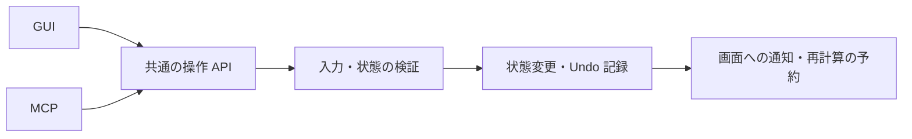

# ソースコードの方針

製品としての要件と初期実装範囲は [要件と設計方針](requirements-and-design.md)、エージェントの作業ルールは [AGENTS.md](../AGENTS.md) を参照する。本書はコードの責務と実装規約を扱う。

## 1. 採用方針と設計の規模

中核を Rust、画面の言語を TypeScript とする。スクリプトは選択した環境の別プロセスで実行する方針。キャンバス試作では React・React Flow・Vite とローカル接続用の axum を導入した。Tauri など未導入のライブラリは検証後に採用を確定する。

通常数百件、場合によって数千件という利用規模に合わせ、UI・操作処理・実行処理・保存処理の境界を明確にして小さく作る。汎用プラグイン基盤や大容量向けの抽象化を先回りして作らない。Polars も必須とはせず、初期フィルタを Rust で直接実装する案と比較する。

## 2. 状態と操作の流れ

プロジェクトの正式な状態は Rust 側に置く。画面には表示に必要なデータと、選択・フォーカス・入力途中の値などの一時的な UI 状態を持たせる。保存対象となる配置や設定は共通操作を通じて Rust 側へ反映する。

セル編集では、画面から対象 ID と新しい値を操作 API に渡す。中核が検証し、状態を更新し、Undo と更新待ちの情報を記録する。MCP も同じ経路を使用する。

- 大きな共有状態を各所から自由に書き換えず、変更の経路を集約する。
- 重い計算や外部プロセスの待機で UI や操作受付を止めない。
- 計算結果の反映時に、その結果が現在の入力・実行に対応するか確認する。
- 永続キャッシュの確定と手入力データの管理を区別する。
- 型定義だけでは外部からの値の正しさを保証できないため、GUI・MCP・ファイル・外部プロセスとの境界で入力を検証する。

## 3. モジュールとファイルの分け方

Tauri を採用した場合の配置例を以下に示す。実装開始前に空のディレクトリを一式作る必要はなく、必要な機能から追加する。

| 配置例 | 責務 |
| --- | --- |
| `src/app/` | 画面全体の組み立てと初期化 |
| `src/features/canvas/` | ノードの配置・接続・表示操作 |
| `src/features/table/` | 表の表示と編集 UI |
| `src/features/node-settings/` | ノード設定 UI |
| `src/api/` | Rust 側との通信と境界の型 |
| `src-tauri/src/domain/` | 表・ノード・接続・値の型と基本制約 |
| `src-tauri/src/application/` | 編集操作、Undo、プロジェクトの状態管理 |
| `src-tauri/src/execution/` | 実行順序、更新判定、キャッシュ、外部プロセス管理 |
| `src-tauri/src/storage/` | プロジェクトの保存と復元 |
| `src-tauri/src/adapters/gui/` | GUI の要求と共通操作の変換 |
| `src-tauri/src/adapters/mcp/` | MCP の要求と共通操作の変換 |

基本の型や表加工を UI・MCP・保存形式に依存させない。adapters には業務上のルールを重複実装せず、共通操作の呼び出しと形式変換を置く。

初期段階は一つの Rust crate 内でモジュールを分ける。独立した利用先やビルド上の理由が生じた時点で crate 分割を検討する。

ファイルは責務で分ける。無関係な機能を一つのファイルへ集めず、関連する小さな処理はまとまりを保つ。行数だけを理由に機械的に分割しない。目的が説明できない `utils` や万能な共通モジュールを増やさない。

## 4. 型・エラー・記述規約

- TypeScript は strict を有効にする。境界の検証を型アサーションだけで代用しない。
- 想定される失敗は Rust の `Result` とエラー型などで表現する。対象や原因を GUI・MCP が扱える情報として返す。
- ファイルが見つからない、入力値が不正、スクリプトが失敗するといった通常起こり得るケースに `unwrap()` / `expect()` を使わない。テスト内の使用などは目的に応じて判断する。
- 失敗を握りつぶしたり、成功したように空の結果へ置き換えたりしない。前回のキャッシュとエラー状態を区別する。
- 識別子は英語、コメント・設計説明は日本語を基本とする。
- コメントはコードの言い換えではなく、判断理由、制約、不変条件を説明する。
- 依存ライブラリは目的を説明できるものだけ追加し、必要になるまで汎用的な抽象化を導入しない。

## 5. テストと自動検査

UI と独立した表加工や検証は単体テストで確認し、ファイル操作・保存・外部プロセスは結合テストで確認する。実装の内部構造をなぞるだけのテストより、利用者から見た振る舞いを確認する。

重点的に確認すること:

- フィルタ結果と型・null の扱い。
- 自動更新、手動ノードでの停止、古い実行結果の破棄。
- 保存・復元、非対応形式の拒否、保存失敗時の既存ファイルの保護。
- スクリプトの正常終了、異常終了、不正な出力、キャンセル、失敗時のキャッシュ維持。
- GUI と MCP から同じ操作をした場合の状態と Undo の整合性。
- 日本語 IME、貼り付け、ズーム中の編集、キャンバス操作との競合。

フォーマットと静的検査を自動化する。Rust では rustfmt / Clippy、TypeScript では型検査とフォーマッタ・リンタを使う方針とし、具体的なツール構成・コマンドは導入時に文書化する。未導入のコマンドを実行済みと記載しない。

## 6. 詳細設計で決めること

- GUI と Rust の間の型共有・生成方法。
- 共通操作 API の具体的な要求・応答とエラー形式。
- 同時編集の競合検出、状態通知、実行の世代管理の方式。
- 非同期ランタイム、処理の実行枠、共有状態の同期方法。
- 実際のディレクトリ構成、フォーマッタ・リンタ・検証コマンド。

これらは上記の責務分割に沿って具体化する。キャンバス試作を実装済みで、現状の配置・制限は [キャンバス試作](canvas-prototype.md)、検証コマンドは [README](../README.md) を参照する。
